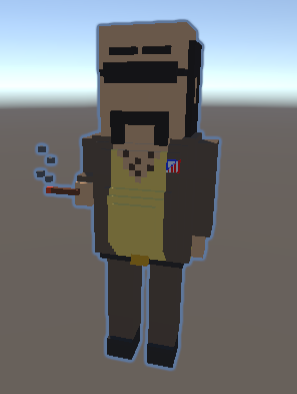
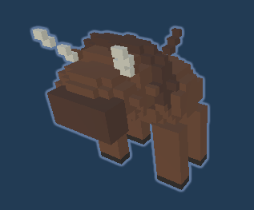
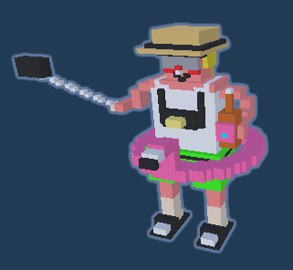
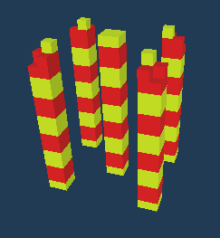
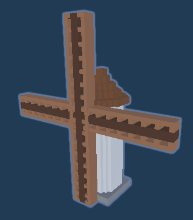
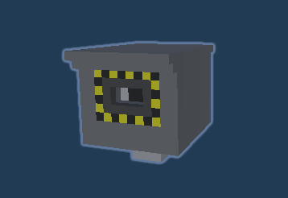

<div align="center">

# 🇪🇸 Spanish Dungeon

**Un *dungeon crawler* arcade en 3D, voxel y por casillas, con mucho humor español.**
**An arcade, grid-based voxel 3D dungeon crawler full of Spanish humour.**


[🇪🇸 Castellano](#-castellano) · [🇬🇧 English](#-english)


</div>

---

## 🎬 Demo

<div align="center">

[](Sergi_Malaguilla/demo.avi)

**▶ [Descargar / ver el vídeo de demostración — Download / watch the demo video (`demo.avi`)](Sergi_Malaguilla/demo.avi)**


</div>

> GitHub no reproduce archivos `.avi` dentro del README: pulsa la imagen o el enlace para abrir/descargar el vídeo.
> GitHub does not play `.avi` files inline: click the image or link to open/download the video.

---

# 🇪🇸 Castellano

## Índice

1. [Descripción](#descripción)
2. [Cómo se juega](#cómo-se-juega)
3. [Controles](#controles)
4. [Personajes, enemigos y trampas](#personajes-enemigos-y-trampas)
5. [Las 10 salas](#las-10-salas)
6. [Funcionalidades técnicas](#funcionalidades-técnicas)
7. [Arquitectura del código](#arquitectura-del-código)
8. [Formato de los mapas](#formato-de-los-mapas)
9. [Estructura del repositorio](#estructura-del-repositorio)
10. [Cómo ejecutarlo](#cómo-ejecutarlo)
11. [Ramas y versiones](#ramas-y-versiones)
12. [Créditos](#créditos)

## Descripción

**Spanish Dungeon** es un juego de exploración de mazmorras en 3D con **cámara ortográfica isométrica**, inspirado en la mecánica de *Looty Dungeon* (Taco Boy Games, 2016). Se desarrolló como proyecto del **Laboratorio de Videojuegos (Ejercicio 3D) de la FIB‑UPC, curso 2025/26 (Q2)**.

El jugador recorre **10 salas** consecutivas. En cada una debe **eliminar a todos los enemigos** para abrir la puerta, **esquivar trampas**, **recoger monedas** y darse prisa, porque a partir de la sala 3 **el suelo se derrumba fila a fila**. En la última sala espera el jefe final.

Lo que lo hace único es su **ambientación española y satírica**: todo está modelado en voxel con MagicaVoxel y las trampas y enemigos clásicos se han reinterpretado. Hay radares de la DGT que disparan multas, molinos manchegos, toros, guiris que dejan cervezas por el suelo, carteristas que te roban monedas y un político como jefe final.

## Cómo se juega

| Mecánica | Descripción |
|---|---|
| **Movimiento por casillas** | Cada pulsación mueve al personaje exactamente una casilla de 1×1 m. Las paredes, puertas cerradas, decorados y los bordes del mapa bloquean el paso. |
| **Combate por contacto** | Para atacar, muévete hacia la casilla donde está el enemigo. Los enemigos normales mueren de un golpe y el jefe necesita varios. |
| **Progresión** | La puerta de cada sala solo se abre (con una animación de subida) cuando **no queda ningún enemigo vivo**. Después, cruza la salida. |
| **Vida** | Tienes **3 corazones**. Cada golpe resta uno y te da un momento de invulnerabilidad (el personaje parpadea). |
| **Monedas** | Son opcionales y sirven de puntuación. Algunos enemigos y trampas te las quitan. |
| **Suelo que se derrumba** | Desde la sala 3 (salvo en la del jefe), 3 s después de entrar el suelo empieza a caer fila a fila desde el fondo. Si caes al vacío, pierdes la partida. |
| **Derrota / Victoria** | Pierdes si te quedas sin corazones o si caes. Ganas si superas la sala 10. |

## Controles

| Tecla | Acción |
|---|---|
| `W` / `↑` | Avanzar |
| `S` / `↓` | Retroceder |
| `A` / `←` | Izquierda |
| `D` / `→` | Derecha |
| `Esc` | Pausar / reanudar |
| `1` … `9`, `0` | *(Depuración)* Saltar directamente a la sala 1‑9; `0` lleva a la sala 10 (jefe) |

## Personajes, enemigos y trampas

| | Entidad | Comportamiento |
|---|---|---|
|  | **Torrento** (jugador) | Es una parodia del protagonista de *Torrente*. Se mueve por casillas y ataca al chocar con los enemigos. |
|  | **Toro** (patrulla) — `1` | Va y viene en línea recta y da media vuelta al encontrar una pared o un precipicio. |
|  | **Carterista** (perseguidor) — `2` | Te persigue cuando estás a 2 casillas o menos. Si te toca, te quita un corazón y **te roba 3 monedas**. |
|  | **Guiri** (trampero) — `3` | Camina en diagonal y deja **botellas de cerveza** tras de sí. |
|  | **Cerveza rota** | Si la pisas, te **emborrachas** y los controles se invierten durante 4 s. |
|  | **Pedro** (jefe final) — `B` | Te persigue por la cuadrícula. Tiene 3 vidas y, cada vez que golpea o recibe un golpe, huye y se vuelve invulnerable unos segundos. |
|  | **Pinchos** — `T` | Tienen un ciclo de reposo, aviso (asoman un poco) y ataque. |
|  | **Molino manchego** — `Y` | Sus aspas giran sin parar y te golpean si las tocas. |
|  | **Radar de la DGT** — `U H J K` | Dispara **multas** en una dirección fija. Cada multa quita 1 corazón y 2 monedas. |
|  | **Moneda** — `C` | Gira sobre sí misma y suma puntuación. |

**Decorados (bloquean el paso):** boca de incendios, farola, mesa de mitin "ESOE", quiosco de lotería y coche de policía.

## Las 10 salas

| Sala | Novedad principal |
|---|---|
| 1 | Tutorial: toros y una fila de pinchos |
| 2 | Más toros y un pasillo de pinchos alternos |
| 3 | Aparecen el carterista y los radares. **Empieza a caer el suelo** |
| 4 | Aparece el guiri y se mezclan carteristas y guiris |
| 5 | Muro de pinchos y molinos que separa el punto de salida |
| 6 | Fila de radares disparando y oleada de carteristas |
| 7 | Salida rodeada de pinchos, con guiris y carteristas |
| 8 | Sala vertical con un corredor de molinos, radares cruzados y pinchos |
| 9 | Sala enorme con una fila de pinchos, bocas de incendio y siete guiris |
| 10 | **Jefe final: Pedro**, en un tablero de ajedrez de pinchos (sin derrumbe) |

## Funcionalidades técnicas

- **Generación de salas desde archivos de texto** (`MapGenerator.cs`). Cada carácter del `.txt` crea una casilla, una pared, un enemigo, una trampa o un decorado.
- **Derrumbe del suelo** mediante corrutinas. Se activa la física (`Rigidbody`) fila a fila para que las casillas caigan de forma realista.
- **Cámara ortográfica isométrica** que sigue al jugador con suavizado.
- **HUD con TextMeshPro**: corazones, monedas y número de sala.
- **Menús**: menú principal, créditos, pausa (`Esc`), *Game Over* y victoria. Los paneles detienen el tiempo (`Time.timeScale = 0`) y el audio.
- **Game feel**: parpadeo de invulnerabilidad, *hitstop* al morir, puerta que sube animada, pinchos con fase de aviso y sonidos para cada interacción.
- **Música y efectos de sonido**: una pista para el menú y otra para la mazmorra, y efectos para cada entidad (sacados de Freesound, con licencia libre).

## Arquitectura del código

Todos los scripts están en [`SpanishDungeon/Assets/Scripts`](SpanishDungeon/Assets/Scripts).

| Área | Script | Función |
|---|---|---|
| Jugador | `PlayerController.cs` | Movimiento por casillas, ataque, detección de suelo y caída, y efecto de la borrachera |
| | `PlayerStats.cs` | Vida, monedas, sala, invulnerabilidad, muerte/victoria y HUD |
| | `CameraController.cs` | Cámara que sigue al jugador con un *offset* fijo |
| Enemigos | `EnemyPatrol.cs` | Toro: patrulla en línea |
| | `Enemigo_basico.cs` | Carterista: persecución por proximidad y robo de monedas |
| | `Guiri.cs` | Movimiento diagonal y rastro de cervezas |
| | `Pedro.cs` / `PedroStats.cs` | IA del jefe (persecución y huida) y sus vidas/invulnerabilidad |
| Trampas | `SpikeTrap.cs` | Pinchos con ciclo de aviso y ataque |
| | `WindmillTrap.cs` | Aspas giratorias con *trigger* |
| | `ArrowTrap.cs` / `ArrowProjectile.cs` | Radar DGT y multa (proyectil) |
| Objetos | `Coin.cs` · `Cerveza.cs` (`CervezaRota`) | Moneda y cerveza que emborracha |
| Mundo | `MapGenerator.cs` | Carga de salas `.txt`, derrumbe y atajos de depuración |
| | `DoorController.cs` · `NextRoomTrigger.cs` | Puerta que se abre al vaciar la sala y paso a la siguiente |
| UI | `MainMenu.cs` · `PauseManager.cs` | Menú principal, créditos y pausa |

**Escenas:** `MenuPrincipal.unity` (menú y créditos) y `SampleScene.unity` (el juego).

## Formato de los mapas

Las salas están en [`SpanishDungeon/Assets/Maps`](SpanishDungeon/Assets/Maps) (`Sala1.txt` … `Sala10.txt`). Cada fila del archivo es una fila del tablero. La primera línea es el fondo de la sala, donde está la salida, y la última es donde aparece el jugador.

| Carácter | Elemento | Carácter | Elemento |
|---|---|---|---|
| `.` | Suelo | `1` | Toro (patrulla) |
| `#` | Pared | `2` | Carterista |
| `D` | Puerta | `3` | Guiri |
| `X` | Salida a la siguiente sala | `B` | Jefe (Pedro) |
| `S` | Inicio del jugador | `T` | Pinchos (sustituyen al suelo) |
| `C` | Moneda | `Y` | Molino |
| `O P Q R V` | Coche de policía, lotería, farola, mesa de mitin, boca de incendios | `U H J K` | Radar mirando en cada una de las 4 direcciones |
| *(espacio)* | Vacío (sin suelo) | | |

## Estructura del repositorio

```
3D_Game_Spanish_Dungeon/
├── SpanishDungeon/          # Proyecto de Unity (abre esta carpeta con Unity Hub)
│   └── Assets/
│       ├── Scripts/         # Código C#
│       ├── Maps/            # Salas en .txt
│       ├── Models/          # Modelos voxel (.vox / .obj) hechos con MagicaVoxel
│       ├── Prefabs/         # Prefabs de entidades
│       ├── Audio/           # Música y efectos
│       ├── Scenes/          # MenuPrincipal y SampleScene
│       └── UI/              # Imagen del menú
├── Sergi_Malaguilla/        # Paquete de entrega
│   ├── Binari/              # Ejecutable de Windows (SpanishDungeon.exe)
│   ├── Projecte/            # Copia del proyecto entregado
│   ├── demo.avi             # Vídeo de demostración
│   ├── memoria.pdf          # Memoria del proyecto (en catalán)
│   └── info.txt             # Miembros del equipo
└── docs/img/                # Imágenes de este README
```

## Cómo ejecutarlo

**Jugar directamente (Windows):** ejecuta `Sergi_Malaguilla/Binari/SpanishDungeon.exe`.

**Abrir el proyecto:**
1. Instala **Unity 2022.3.32f1** desde Unity Hub.
2. *Add project from disk* → selecciona la carpeta `SpanishDungeon/`.
3. Abre la escena `Assets/Scenes/MenuPrincipal.unity` y pulsa ▶ Play.

## Ramas y versiones

| Rama | Contenido |
|---|---|
| `main` | Estado estable del proyecto |
| `v1.0` | **Versión entregada** en la asignatura (congelada) |
| `dev` | Desarrollo posterior a la entrega con nuevas mejoras |

## Créditos

- **Sergi Malaguilla Bombín**
- **Adrià Aguilar Garcia**

Proyecto de la asignatura de Videojuegos de la FIB (UPC), curso 2025/26. Los modelos son originales (hechos con MagicaVoxel) y el audio procede de Freesound (CC0). Todos los derechos reservados (ver [LICENSE](LICENSE)).

---

# 🇬🇧 English

## Table of contents

1. [Overview](#overview)
2. [How to play](#how-to-play)
3. [Controls](#controls)
4. [Characters, enemies and traps](#characters-enemies-and-traps)
5. [The 10 rooms](#the-10-rooms)
6. [Technical features](#technical-features)
7. [Code architecture](#code-architecture)
8. [Map format](#map-format)
9. [Repository layout](#repository-layout)
10. [Running it](#running-it)
11. [Branches and versions](#branches-and-versions)
12. [Credits](#credits)

## Overview

**Spanish Dungeon** is a 3D dungeon crawler with an **orthographic isometric camera**, inspired by the gameplay of *Looty Dungeon* (Taco Boy Games, 2016). It was built for the **Video Games Lab (3D assignment) at FIB‑UPC, 2025/26 (Q2)**.

The player goes through **10 consecutive rooms**. In each one you must **defeat every enemy** to open the door, **dodge traps**, **collect coins** and keep moving, because from room 3 onwards **the floor crumbles row by row**. The final boss waits in the last room.

What makes it unique is its **satirical Spanish setting**: everything is voxel art made in MagicaVoxel, and classic traps and enemies are reimagined. There are DGT speed cameras that shoot traffic fines, La Mancha windmills, bulls, tourists who leave beer bottles behind them, pickpockets who steal your coins, and a politician as the final boss.

## How to play

| Mechanic | Description |
|---|---|
| **Grid movement** | Each key press moves the character exactly one 1×1 m tile. Walls, closed doors, props and the edges of the map block movement. |
| **Bump combat** | To attack, move into the tile where an enemy stands. Regular enemies die in one hit; the boss needs several. |
| **Progression** | Each room's door only opens (with a rising animation) once **no enemies are left alive**. Then walk through the exit. |
| **Health** | You have **3 hearts**. Each hit takes one and gives you a moment of invulnerability (the character blinks). |
| **Coins** | They are optional and work as your score. Some enemies and traps take them from you. |
| **Crumbling floor** | From room 3 on (except the boss room), 3 s after you enter, the floor starts falling row by row from the back. Falling into the void loses the game. |
| **Lose / Win** | You lose if you run out of hearts or fall. You win by clearing room 10. |

## Controls

| Key | Action |
|---|---|
| `W` / `↑` | Forward |
| `S` / `↓` | Back |
| `A` / `←` | Left |
| `D` / `→` | Right |
| `Esc` | Pause / resume |
| `1` … `9`, `0` | *(Debug)* Jump straight to room 1‑9; `0` goes to room 10 (boss) |

## Characters, enemies and traps

| | Entity | Behaviour |
|---|---|---|
|  | **Torrento** (player) | A parody of the main character of the Spanish film *Torrente*. Moves tile by tile and attacks by bumping into enemies. |
|  | **Bull** (patrol) — `1` | Walks back and forth in a straight line and turns around at walls or ledges. |
|  | **Pickpocket** (chaser) — `2` | Chases you when you are 2 tiles away or closer. If it touches you, it takes a heart and **steals 3 coins**. |
|  | **Guiri** (tourist trapper) — `3` | Wanders diagonally and leaves **beer bottles** behind it. |
|  | **Broken beer** | If you step on it you get **drunk** and your controls are reversed for 4 s. |
|  | **Pedro** (final boss) — `B` | Chases you around the grid. Has 3 lives and, every time it lands or takes a hit, it runs away and becomes invulnerable for a few seconds. |
|  | **Spikes** — `T` | Cycle through rest, warning (they poke out a little) and attack. |
|  | **Windmill** — `Y` | Its blades spin constantly and hit you if you touch them. |
|  | **DGT speed camera** — `U H J K` | Fires **traffic fines** in a fixed direction. Each fine takes 1 heart and 2 coins. |
|  | **Coin** — `C` | Spins in place and adds to your score. |

**Props (they block movement):** fire hydrant, street lamp, "ESOE" rally table, lottery kiosk and police car.

## The 10 rooms

| Room | Main twist |
|---|---|
| 1 | Tutorial: bulls and a row of spikes |
| 2 | More bulls and a corridor of alternating spikes |
| 3 | Pickpockets and speed cameras appear. **The floor starts to crumble** |
| 4 | The guiri appears and pickpockets and guiris mix |
| 5 | A wall of spikes and windmills cuts off the starting point |
| 6 | A row of firing speed cameras and a wave of pickpockets |
| 7 | An exit surrounded by spikes, with guiris and pickpockets |
| 8 | A tall room with a windmill corridor, crossing speed cameras and spikes |
| 9 | A huge room with a row of spikes, fire hydrants and seven guiris |
| 10 | **Final boss: Pedro**, on a checkerboard of spikes (no crumbling) |

## Technical features

- **Rooms built from text files** (`MapGenerator.cs`). Each character in the `.txt` spawns a tile, wall, enemy, trap or prop.
- **Crumbling floor** driven by coroutines. Physics (`Rigidbody`) is switched on row by row so the tiles fall realistically.
- **Orthographic isometric camera** that follows the player smoothly.
- **TextMeshPro HUD**: hearts, coins and room number.
- **Menus**: main menu, credits, pause (`Esc`), *Game Over* and victory. The panels stop time (`Time.timeScale = 0`) and audio.
- **Game feel**: invulnerability blinking, *hitstop* on death, an animated rising door, spikes with a warning phase and a sound for every interaction.
- **Music and SFX**: one track for the menu and another for the dungeon, plus effects for every entity (taken from Freesound, freely licensed).

## Code architecture

All scripts live in [`SpanishDungeon/Assets/Scripts`](SpanishDungeon/Assets/Scripts).

| Area | Script | Role |
|---|---|---|
| Player | `PlayerController.cs` | Grid movement, attacking, floor detection and falling, and the drunk effect |
| | `PlayerStats.cs` | Health, coins, room, invulnerability, death/victory and HUD |
| | `CameraController.cs` | Camera that follows the player with a fixed offset |
| Enemies | `EnemyPatrol.cs` | Bull: straight-line patrol |
| | `Enemigo_basico.cs` | Pickpocket: chases when close and steals coins |
| | `Guiri.cs` | Diagonal movement and a trail of beers |
| | `Pedro.cs` / `PedroStats.cs` | Boss AI (chase and flee) and its lives/invulnerability |
| Traps | `SpikeTrap.cs` | Spikes with a warning and attack cycle |
| | `WindmillTrap.cs` | Spinning blades with a trigger |
| | `ArrowTrap.cs` / `ArrowProjectile.cs` | DGT speed camera and fine (projectile) |
| Items | `Coin.cs` · `Cerveza.cs` (`CervezaRota`) | Coin and the beer that makes you drunk |
| World | `MapGenerator.cs` | `.txt` room loading, crumbling and debug shortcuts |
| | `DoorController.cs` · `NextRoomTrigger.cs` | Door that opens once the room is cleared, and the move to the next room |
| UI | `MainMenu.cs` · `PauseManager.cs` | Main menu, credits and pause |

**Scenes:** `MenuPrincipal.unity` (menu and credits) and `SampleScene.unity` (the game).

## Map format

Rooms live in [`SpanishDungeon/Assets/Maps`](SpanishDungeon/Assets/Maps) (`Sala1.txt` … `Sala10.txt`). Each line in the file is one row of the board. The first line is the back of the room, where the exit is, and the last line is where the player starts.

| Char | Element | Char | Element |
|---|---|---|---|
| `.` | Floor | `1` | Bull (patrol) |
| `#` | Wall | `2` | Pickpocket |
| `D` | Door | `3` | Guiri |
| `X` | Exit to the next room | `B` | Boss (Pedro) |
| `S` | Player start | `T` | Spikes (replace the floor) |
| `C` | Coin | `Y` | Windmill |
| `O P Q R V` | Police car, lottery kiosk, street lamp, rally table, fire hydrant | `U H J K` | Speed camera facing each of the 4 directions |
| *(space)* | Void (no floor) | | |

## Repository layout

```
3D_Game_Spanish_Dungeon/
├── SpanishDungeon/          # Unity project (open this folder in Unity Hub)
│   └── Assets/
│       ├── Scripts/         # C# code
│       ├── Maps/            # Rooms as .txt
│       ├── Models/          # Voxel models (.vox / .obj) made in MagicaVoxel
│       ├── Prefabs/         # Entity prefabs
│       ├── Audio/           # Music and SFX
│       ├── Scenes/          # MenuPrincipal and SampleScene
│       └── UI/              # Menu artwork
├── Sergi_Malaguilla/        # Submission package
│   ├── Binari/              # Windows build (SpanishDungeon.exe)
│   ├── Projecte/            # Copy of the submitted project
│   ├── demo.avi             # Demo video
│   ├── memoria.pdf          # Project report (in Catalan)
│   └── info.txt             # Team members
└── docs/img/                # Images used in this README
```

## Running it

**Play right away (Windows):** run `Sergi_Malaguilla/Binari/SpanishDungeon.exe`.

**Open the project:**
1. Install **Unity 2022.3.32f1** through Unity Hub.
2. *Add project from disk* → pick the `SpanishDungeon/` folder.
3. Open `Assets/Scenes/MenuPrincipal.unity` and press ▶ Play.

## Branches and versions

| Branch | Contents |
|---|---|
| `main` | Stable state of the project |
| `v1.0` | **Submitted version** for the course (frozen) |
| `dev` | Post-submission development with new improvements |

## Credits

- **Sergi Malaguilla Bombín**
- **Adrià Aguilar Garcia**

Made for the Video Games course at FIB (UPC), 2025/26. The models are original (made in MagicaVoxel) and the audio comes from Freesound (CC0). All rights reserved (see [LICENSE](LICENSE)).
