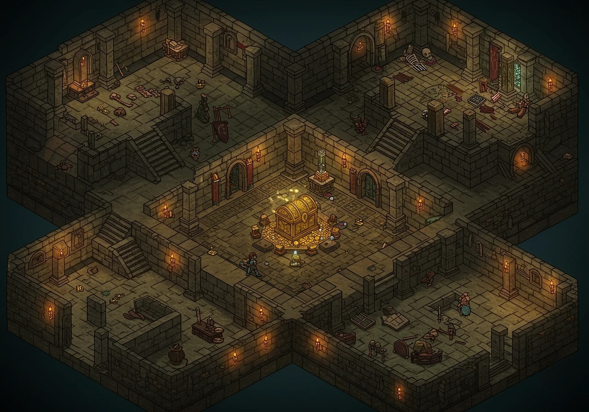
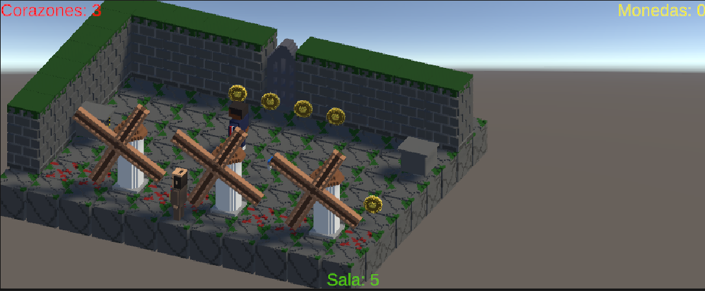
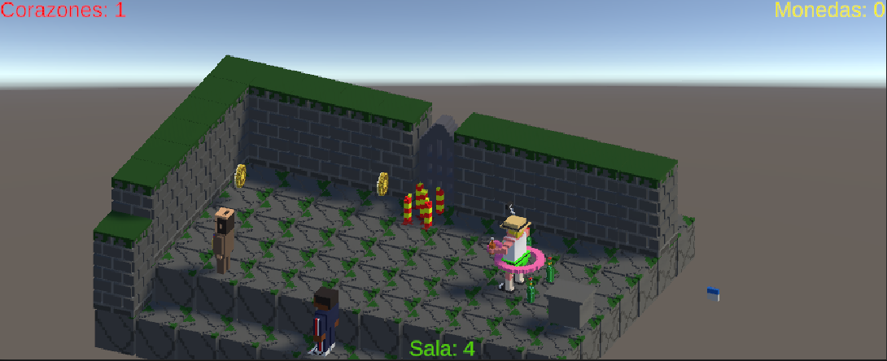
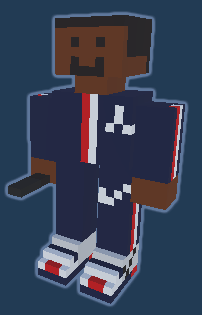
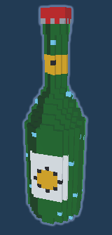
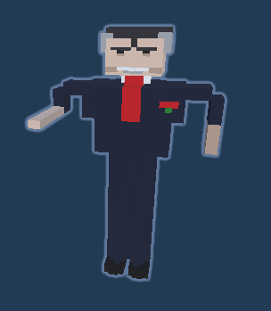
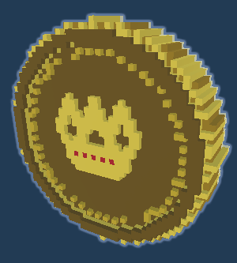

<div align="center">

# 🇪🇸 Spanish Dungeon

**Un *dungeon crawler* arcade en 3D, voxel y por casillas, con mucho humor español.**
**An arcade, grid-based voxel 3D dungeon crawler full of Spanish humour.**


[](https://github.com/semabo29/3D_Game_Spanish_Dungeon/actions/workflows/build.yml)


[🇪🇸 Castellano](#-castellano) · [🇬🇧 English](#-english)

**🎮 [Jugar en el navegador / Play in the browser](https://semabo29.github.io/3D_Game_Spanish_Dungeon/)** · **💾 [Descargar .exe (dev) / Download .exe (dev)](https://github.com/semabo29/3D_Game_Spanish_Dungeon/releases/tag/dev-latest)**



</div>

---

## 🎬 Demo

<div align="center">

[](Sergi_Malaguilla/demo.avi)

**▶ [Descargar / ver el vídeo de demostración — Download / watch the demo video (`demo.avi`)](Sergi_Malaguilla/demo.avi)**



</div>

> GitHub no reproduce archivos `.avi` dentro del README: pulsa la imagen o el enlace para abrir/descargar el vídeo.
> GitHub does not play `.avi` files inline: click the image or link to open/download the video.

---

# 🇪🇸 Castellano

## 🚧 Novedades en `dev` (después de la entrega)

> Esta rama sigue evolucionando el juego. La versión entregada está congelada en la rama `v1.0`.

**Game feel**
- 💥 Los enemigos, el jugador, las monedas y las multas **estallan en vóxeles** del color de cada modelo.
- 📳 **Temblor de cámara** y **hitstop** al golpear, recibir daño o derrotar al jefe.
- 💬 **Textos flotantes**: "¡ZAS!", "¡OLÉ!", "¡MULTA!", "¡Mi cartera!", "¡Cornada!", "¡HIP!"…
- ⚠️ **Aviso de derrumbe**: cada fila de suelo tiembla antes de caer.
- 🟥 Flash rojo de pantalla al recibir daño.

**Interfaz y progresión**
- 🏷️ **Cartel de sala** con nombre propio: *San Fermín, La Plaza de Toros, Las Ramblas, Benidorm, La Mancha, La A‑7, Magaluf, La Feria de Abril, Lloret de Mar* y *El Congreso*.
- ⏱️ Cronómetro, avisos en pantalla y **barra de vida del jefe**.
- 🏆 **Puntuación y récords persistentes** (mejor puntuación, mejor sala, victorias y mejor tiempo), visibles en el menú principal y en las pantallas finales.
- 🔥 **Combos**: encadenar muertes en menos de 2 s da "¡DOBLE!", "¡TRIPLE!"… y una moneda extra.
- 🎟️ **Lotería**: cada 15 monedas "¡TE HA TOCADO EL GORDO!" y ganas un corazón (máximo 5). Ahora las monedas sirven para algo más que la puntuación.

**Jefe final**
- 🗳️ Pedro suelta frases satíricas al golpear y al recibir golpes, entra en una **fase 2 más rápida** en su última vida y, al ser derrotado, **dimite** con una gran explosión y suelta 10 monedas.

**Escenarios y ambientación (nuevo)**
- 🌅 **Un escenario de fondo distinto por sala**, hecho con modelos voxel generados por código y con paralaje: casas con balcones y campanarios con cigüeña en San Fermín, la plaza de toros, el ensanche y la basílica de las torres en Las Ramblas, rascacielos, playa y un **sol con gafas de sol** en Benidorm, molinos girando y un castillo en La Mancha, la autovía con coches, carteles de "A‑7" y "SONRIA" y el toro negro en la colina, hoteles y neones de Magaluf de noche, la portada iluminada y las casetas de la Feria, el castillo y los barcos de Lloret, y el Congreso con leones bajo una tormenta con rayos.
- 💡 Iluminación propia de cada sala: mañana, atardecer y noche (con una luz que acompaña a Torrento).
- 🎊 Partículas ambientales: confeti y pañuelos, hojas, polvo, luciérnagas y hasta **papeles del BOE** cayendo en el Congreso.
- 🎏 Guirnaldas de banderines y farolillos que se balancean sobre las salas, y **palomas** que picotean y salen volando ("¡Currucucú!").

**Física y animación (nuevo)**
- 🧱 **La sala se monta sola** al entrar: el suelo emerge desde el jugador, las paredes caen del cielo y el resto aparece con un saltito.
- 🐸 Animación procedural de personajes: saltito al avanzar, *squash & stretch*, respiración, contoneo, embestida al atacar y polvo al aterrizar.
- 🪀 Los enemigos derrotados **salen volando enteros** como muñecos de trapo, y los vóxeles de las explosiones **rebotan por el suelo**.
- 🍊 **Objetos rompibles**: macetas con geranios, botijos y cajas de naranjas (las naranjas ruedan por la sala). A veces esconden monedas; el agua del botijo quita la borrachera.

**Objetos nuevos (nuevo)**
| Objeto | Efecto |
|---|---|
| 🥖 Bocadillo de calamares | +1 corazón (o +3 monedas si ya estás a tope) |
| 🍫 Churros con chocolate | Más velocidad durante 7 s |
| 🪭 Abanico flamenco | Para el siguiente golpe ("¡Olé!") |
| 💤 Almohada de la siesta | Todos los enemigos y radares se duermen 5 s (Pedro no: está en el escaño) |
| 🍖 Jamón pata negra | +5 monedas |

**Humor (nuevo)**
- Frases de cada sala ("Esos no son gigantes, son molinos", "Radar a 300 metros. Sonría"…), gritos específicos para cada enemigo, **causa de la muerte** en la pantalla de Game Over ("pinchado como una aceituna", "víctima de un decreto ley"…), consejos de la abuela en el menú de pausa y frases en el menú principal.
- 🏅 **Logros** con nombre propio (25 en total) ("Más rico que un emérito", "Gravedad 1 - Torrento 0", "Espantapalomas"…), con aviso en pantalla y menú de logros.

**Interfaz, accesibilidad y control (nuevo)**
- ❤️ HUD nuevo: corazones y monedas en *pixel art*, barra de la lotería, progreso de salas, power-ups activos, latido y viñeta roja cuando te queda un corazón, fundido entre salas y tutorial en las primeras partidas.
- ⚙️ **Menú de opciones** (desde el menú principal y la pausa): volumen, intensidad del temblor, quitar destellos, quitar el hitstop, tamaño de la interfaz (100/125/150 %), mantener tecla para avanzar, avisos de peligro, cronómetro, efectos ambientales y pantalla completa.
- 🎮 **Control más fluido**: se recuerda la tecla pulsada a mitad de paso, se puede mantener la tecla para avanzar y hay **soporte de mando** (stick o cruceta, *Start* para pausar).
- ⚠️ **Avisos de peligro**: marca roja en el suelo de los pinchos y los radares parpadean antes de disparar.
- 🔊 Efectos de sonido sintetizados por código (recoger, power-ups, romper, logros, palomas, truenos…).

**Banda sonora, tienda y sucesos (nuevo)**
- 🎺 **Banda sonora original generada por código**: un tema distinto para cada sala (charanga en San Fermín, pasodoble en la plaza, rumba en Las Ramblas, disco de chiringuito en Benidorm, guitarra y flauta en La Mancha, sevillanas en la Feria, marcha con órgano contra Pedro...), con fundido entre salas, aceleración en la fase final del jefe y fanfarria de victoria. En Opciones se puede volver a la música original y ajustar su volumen aparte.
- 🍺 **El chiringuito de Paco**: al salir de las salas 3, 6 y 9 paras a gastar monedas en bocadillos, caña y tapa (cura total), abanicos, churros, un **seguro a todo riesgo** que te salva una vez de morir (no cubre caídas: letra pequeña) y décimos de lotería.
- 📰 **Sucesos de ÚLTIMA HORA**: algunas salas traen *happy hour* (monedas dobles), huelga de radares o lluvia de monedas.

**Más vida en las salas (nuevo)**
- 🏮 **Farolas fernandinas** voxel en lugar de los postes antiguos, que eran demasiado altos y tapaban la sala. De noche se encienden de verdad y parpadean un poco.
- 🐈 **Gatos callejeros** (atigrado, negro o blanco) que dormitan por la sala y salen por patas con un «¡Miau, pesao!» si te acercas.
- 🧹 **Sala perfecta**: si limpias una sala sin recibir ni un golpe, +3 monedas y confeti.
- 🗞️ **Titular de *El Chismoso*** en la pantalla final, según cómo hayas muerto (o ganado).
- 🐦 **Gaviotas ladronas** en Benidorm y Lloret: de vez en cuando una se lanza en picado a tu casilla para robarte una moneda. La casilla se marca y se oye el graznido, así que si te apartas a tiempo la esquivas.
- 🏅 **5 logros nuevos** (25 en total): gatos, salas perfectas, gaviotas, sombreros y completar la mazmorra en *Ibérico*.
- 🏆 **Tus 5 mejores partidas** en el menú principal (botón «Récords»).
- ⏸️ El menú de pausa muestra el **resumen de la partida** (sala, tiempo, monedas, enemigos y dificultad).
- ♿ Opción de **movimiento reducido**: sin montaje animado de las salas ni movimiento del fondo.

**Sombreros y dificultad (nuevo)**
- 🎩 **9 sombreros para Torrento** que se desbloquean con logros: boina, pañuelo rojo, cordobés, sombrero de paja, casco de obra, montera, peineta, flotador de guiri y, con los 25 logros, la corona. Se eligen en Opciones.
- 🎚️ **Dificultad**: *Turista* (+2 corazones, puntuación x0,75), *Normal* e *Ibérico* (un corazón menos, puntuación x1,5).

**Correcciones**
- La sala 10 usaba una `s` minúscula como inicio y no colocaba al jugador: ahora los mapas no distinguen mayúsculas de minúsculas.
- `Esc` en Game Over / Victoria ya no reanuda el tiempo. Además, `P` también pausa.
- Las multas en vuelo se eliminan al cambiar de sala.
- Los atajos `0`‑`9` solo funcionan en el editor o en builds de desarrollo.
- Rendimiento: el jugador se cachea en lugar de buscarlo en cada frame en cada entidad.
- Los scripts en Windows‑1252 se han convertido a UTF‑8.

## Índice

1. [Descripción](#descripción)
2. [Cómo se juega](#cómo-se-juega)
3. [Controles](#controles)
4. [Personajes, enemigos y trampas](#personajes-enemigos-y-trampas)
5. [Las 10 salas](#las-10-salas)
6. [Funcionalidades técnicas](#funcionalidades-técnicas)
7. [Arquitectura del código](#arquitectura-del-código)
8. [Formato de los mapas](#formato-de-los-mapas)
9. [Estructura del repositorio](#estructura-del-repositorio)
10. [Cómo ejecutarlo](#cómo-ejecutarlo)
11. [Ramas y versiones](#ramas-y-versiones)
12. [Créditos](#créditos)

## Descripción

**Spanish Dungeon** es un juego de exploración de mazmorras en 3D con **cámara ortográfica isométrica**, inspirado en la mecánica de *Looty Dungeon* (Taco Boy Games, 2016). Se desarrolló como proyecto del **Laboratorio de Videojuegos (Ejercicio 3D) de la FIB‑UPC, curso 2025/26 (Q2)**.

El jugador recorre **10 salas** consecutivas. En cada una debe **eliminar a todos los enemigos** para abrir la puerta, **esquivar trampas**, **recoger monedas** y darse prisa, porque a partir de la sala 3 **el suelo se derrumba fila a fila**. En la última sala espera el jefe final.

Lo que lo hace único es su **ambientación española y satírica**: todo está modelado en voxel con MagicaVoxel y las trampas y enemigos clásicos se han reinterpretado. Hay radares de la DGT que disparan multas, molinos manchegos, toros, guiris que dejan cervezas por el suelo, carteristas que te roban monedas y un político como jefe final.

## Cómo se juega

| Mecánica | Descripción |
|---|---|
| **Movimiento por casillas** | Cada pulsación mueve al personaje exactamente una casilla de 1×1 m. Las paredes, puertas cerradas, decorados y los bordes del mapa bloquean el paso. |
| **Combate por contacto** | Para atacar, muévete hacia la casilla donde está el enemigo. Los enemigos normales mueren de un golpe y el jefe necesita varios. |
| **Progresión** | La puerta de cada sala solo se abre (con una animación de subida) cuando **no queda ningún enemigo vivo**. Después, cruza la salida. |
| **Vida** | Tienes **3 corazones**. Cada golpe resta uno y te da un momento de invulnerabilidad (el personaje parpadea). |
| **Monedas** | Son opcionales y sirven de puntuación. Algunos enemigos y trampas te las quitan. |
| **Suelo que se derrumba** | Desde la sala 3 (salvo en la del jefe), 3 s después de entrar el suelo empieza a caer fila a fila, desde la entrada hacia la salida. Si caes al vacío, pierdes la partida. |
| **Derrota / Victoria** | Pierdes si te quedas sin corazones o si caes. Ganas si superas la sala 10. |

## Controles

| Tecla | Acción |
|---|---|
| `W` / `↑` | Avanzar |
| `S` / `↓` | Retroceder |
| `A` / `←` | Izquierda |
| `D` / `→` | Derecha |
| `Esc` / `P` / *Start* | Pausar / reanudar |
| Stick o cruceta del mando | Moverse |
| `1` … `9`, `0` | *(Depuración, solo en el editor o en builds de desarrollo)* Saltar a la sala 1‑9; `0` lleva a la sala 10 (jefe) |

## Personajes, enemigos y trampas

| | Entidad | Comportamiento |
|---|---|---|
|  | **Torrento** (jugador) | Es una parodia del protagonista de *Torrente*. Se mueve por casillas y ataca al chocar con los enemigos. |
|  | **Toro** (patrulla) — `1` | Va y viene en línea recta y da media vuelta al encontrar una pared o un precipicio. |
|  | **Carterista** (perseguidor) — `2` | Te persigue cuando estás a 2 casillas o menos. Si te toca, te quita un corazón y **te roba 3 monedas**. |
|  | **Guiri** (trampero) — `3` | Camina en diagonal y deja **botellas de cerveza** tras de sí. |
|  | **Cerveza rota** | Si la pisas, te **emborrachas** y los controles se invierten durante 4 s. |
|  | **Pedro** (jefe final) — `B` | Te persigue por la cuadrícula. Tiene 3 vidas y, cada vez que golpea o recibe un golpe, huye y se vuelve invulnerable unos segundos. |
|  | **Pinchos** — `T` | Tienen un ciclo de reposo, aviso (asoman un poco) y ataque. |
|  | **Molino manchego** — `Y` | Sus aspas giran sin parar y te golpean si las tocas. |
|  | **Radar de la DGT** — `U H J K` | Dispara **multas** en una dirección fija. Cada multa quita 1 corazón y 2 monedas. |
|  | **Moneda** — `C` | Gira sobre sí misma y suma puntuación. |

**Decorados (bloquean el paso):** boca de incendios, farola, mesa de mitin "ESOE", quiosco de lotería y coche de policía.

## Las 10 salas

| Sala | Novedad principal |
|---|---|
| 1 | Tutorial: toros y una fila de pinchos |
| 2 | Más toros y un pasillo de pinchos alternos |
| 3 | Aparecen el carterista y los radares. **Empieza a caer el suelo** |
| 4 | Aparece el guiri y se mezclan carteristas y guiris |
| 5 | Muro de pinchos y molinos que separa el punto de salida |
| 6 | Fila de radares disparando y oleada de carteristas |
| 7 | Salida rodeada de pinchos, con guiris y carteristas |
| 8 | Sala vertical con un corredor de molinos, radares cruzados y pinchos |
| 9 | Sala enorme con una fila de pinchos, bocas de incendio y siete guiris |
| 10 | **Jefe final: Pedro**, en un tablero de ajedrez de pinchos (sin derrumbe) |

## Funcionalidades técnicas

- **Generación de salas desde archivos de texto** (`MapGenerator.cs`). Cada carácter del `.txt` crea una casilla, una pared, un enemigo, una trampa o un decorado.
- **Derrumbe del suelo** mediante corrutinas. Se activa la física (`Rigidbody`) fila a fila para que las casillas caigan de forma realista.
- **Cámara ortográfica isométrica** que sigue al jugador con suavizado.
- **HUD con TextMeshPro**: corazones, monedas y número de sala.
- **Menús**: menú principal, créditos, pausa (`Esc`), *Game Over* y victoria. Los paneles detienen el tiempo (`Time.timeScale = 0`) y el audio.
- **Game feel**: parpadeo de invulnerabilidad, *hitstop* al morir, puerta que sube animada, pinchos con fase de aviso y sonidos para cada interacción.
- **Música y efectos de sonido**: una pista para el menú y otra para la mazmorra, y efectos para cada entidad (sacados de Freesound, con licencia libre).

## Arquitectura del código

Todos los scripts están en [`SpanishDungeon/Assets/Scripts`](SpanishDungeon/Assets/Scripts).

| Área | Script | Función |
|---|---|---|
| Jugador | `PlayerController.cs` | Movimiento por casillas, ataque, detección de suelo y caída, y efecto de la borrachera |
| | `PlayerStats.cs` | Vida, monedas, sala, invulnerabilidad, muerte/victoria y HUD |
| | `CameraController.cs` | Cámara que sigue al jugador con un *offset* fijo |
| Enemigos | `EnemyPatrol.cs` | Toro: patrulla en línea |
| | `Enemigo_basico.cs` | Carterista: persecución por proximidad y robo de monedas |
| | `Guiri.cs` | Movimiento diagonal y rastro de cervezas |
| | `Pedro.cs` / `PedroStats.cs` | IA del jefe (persecución y huida) y sus vidas/invulnerabilidad |
| Trampas | `SpikeTrap.cs` | Pinchos con ciclo de aviso y ataque |
| | `WindmillTrap.cs` | Aspas giratorias con *trigger* |
| | `ArrowTrap.cs` / `ArrowProjectile.cs` | Radar DGT y multa (proyectil) |
| Objetos | `Coin.cs` · `Cerveza.cs` (`CervezaRota`) | Moneda y cerveza que emborracha |
| Mundo | `MapGenerator.cs` | Carga de salas `.txt`, derrumbe y atajos de depuración |
| | `DoorController.cs` · `NextRoomTrigger.cs` | Puerta que se abre al vaciar la sala y paso a la siguiente |
| UI | `MainMenu.cs` · `PauseManager.cs` | Menú principal, créditos y pausa |

**Escenas:** `MenuPrincipal.unity` (menú y créditos) y `SampleScene.unity` (el juego).

## Formato de los mapas

Las salas están en [`SpanishDungeon/Assets/Maps`](SpanishDungeon/Assets/Maps) (`Sala1.txt` … `Sala10.txt`). Cada fila del archivo es una fila del tablero. La primera línea es el fondo de la sala, donde está la salida, y la última es donde aparece el jugador.

| Carácter | Elemento | Carácter | Elemento |
|---|---|---|---|
| `.` | Suelo | `1` | Toro (patrulla) |
| `#` | Pared | `2` | Carterista |
| `D` | Puerta | `3` | Guiri |
| `X` | Salida a la siguiente sala | `B` | Jefe (Pedro) |
| `S` | Inicio del jugador | `T` | Pinchos (sustituyen al suelo) |
| `C` | Moneda | `Y` | Molino |
| `O P Q R V` | Coche de policía, lotería, farola, mesa de mitin, boca de incendios | `U H J K` | Radar mirando en cada una de las 4 direcciones |
| *(espacio)* | Vacío (sin suelo) | | |

## Estructura del repositorio

```
3D_Game_Spanish_Dungeon/
├── SpanishDungeon/          # Proyecto de Unity (abre esta carpeta con Unity Hub)
│   └── Assets/
│       ├── Scripts/         # Código C#
│       ├── Maps/            # Salas en .txt
│       ├── Models/          # Modelos voxel (.vox / .obj) hechos con MagicaVoxel
│       ├── Prefabs/         # Prefabs de entidades
│       ├── Audio/           # Música y efectos
│       ├── Scenes/          # MenuPrincipal y SampleScene
│       └── UI/              # Imagen del menú
├── Sergi_Malaguilla/        # Paquete de entrega
│   ├── Binari/              # Ejecutable de Windows (SpanishDungeon.exe)
│   ├── Projecte/            # Copia del proyecto entregado
│   ├── demo.avi             # Vídeo de demostración
│   ├── memoria.pdf          # Memoria del proyecto (en catalán)
│   └── info.txt             # Miembros del equipo
└── docs/img/                # Imágenes de este README
```

## Cómo ejecutarlo

**Jugar en el navegador (versión `dev`):** [https://semabo29.github.io/3D_Game_Spanish_Dungeon/](https://semabo29.github.io/3D_Game_Spanish_Dungeon/)

**Descargar la última versión `dev` (Windows):** en la [release `dev-latest`](https://github.com/semabo29/3D_Game_Spanish_Dungeon/releases/tag/dev-latest) descarga `SpanishDungeon-Windows.zip`, descomprímelo y ejecuta `SpanishDungeon.exe`.

Ambas se compilan solas en GitHub Actions (GameCI) cada vez que se sube algo a `dev`, así que no hace falta tener Unity instalado.

**Versión entregada (Windows):** ejecuta `Sergi_Malaguilla/Binari/SpanishDungeon.exe`.

**Abrir el proyecto:**
1. Instala **Unity 2022.3.32f1** desde Unity Hub.
2. *Add project from disk* → selecciona la carpeta `SpanishDungeon/`.
3. Abre la escena `Assets/Scenes/MenuPrincipal.unity` y pulsa ▶ Play.

## Ramas y versiones

| Rama | Contenido |
|---|---|
| `main` | Estado estable del proyecto |
| `v1.0` | **Versión entregada** en la asignatura (congelada) |
| `dev` | Desarrollo posterior a la entrega con nuevas mejoras |

## Créditos

- **Sergi Malaguilla Bombín**
- **Adrià Aguilar Garcia**

Proyecto de la asignatura de Videojuegos de la FIB (UPC), curso 2025/26. Los modelos son originales (hechos con MagicaVoxel) y el audio procede de Freesound (CC0). 

**Licencia:** todos los derechos reservados. Este repositorio es propiedad exclusiva de Sergi Malaguilla Bombín y Adrià Aguilar García. Que sea público no da permiso para copiarlo, modificarlo, reutilizarlo ni redistribuirlo; solo se puede ver y jugar a las versiones publicadas. Consulta [LICENSE](LICENSE).

---

# 🇬🇧 English

## 🚧 What's new in `dev` (after the submission)

> This branch keeps evolving the game. The submitted version is frozen in the `v1.0` branch.

**Game feel**
- 💥 Enemies, the player, coins and fines **burst into voxels** in each model's colour.
- 📳 **Screen shake** and **hitstop** when hitting, taking damage or defeating the boss.
- 💬 **Floating text**: "¡ZAS!", "¡OLÉ!", "¡MULTA!", "¡Mi cartera!", "¡Cornada!", "¡HIP!"…
- ⚠️ **Crumble warning**: each row of floor shakes before it falls.
- 🟥 Red screen flash when you take damage.

**UI and progression**
- 🏷️ **Room title cards** with names: *San Fermín, La Plaza de Toros, Las Ramblas, Benidorm, La Mancha, La A‑7, Magaluf, La Feria de Abril, Lloret de Mar* and *El Congreso*.
- ⏱️ Run timer, on-screen messages and a **boss health bar**.
- 🏆 **Score and persistent records** (high score, best room, wins and best time), shown in the main menu and on the end screens.
- 🔥 **Combos**: chaining kills within 2 s gives "¡DOBLE!", "¡TRIPLE!"… and a bonus coin.
- 🎟️ **Lottery**: every 15 coins you hit "EL GORDO" and gain a heart (up to 5). Coins now matter beyond the score.

**Final boss**
- 🗳️ Pedro shouts satirical lines when he lands or takes a hit, enters a **faster phase 2** on his last life and, when defeated, **resigns** in a big explosion and drops 10 coins.

**Scenery and atmosphere (new)**
- 🌅 **A different backdrop for every room**, built from code-generated voxel models with parallax: houses with balconies and stork-topped bell towers in San Fermín, the bullring, the Eixample and the many-spired basilica in Las Ramblas, skyscrapers, a beach and a **sun wearing sunglasses** in Benidorm, spinning windmills and a castle in La Mancha, the motorway with traffic, "A‑7" and "SONRIA" signs and the black bull on the hill, Magaluf's hotels and neon at night, the lit-up gate and casetas of the Feria, Lloret's castle and boats, and the Congress with its lions under a lightning storm.
- 💡 Per-room lighting: morning, sunset and night (with a light that follows Torrento).
- 🎊 Ambient particles: confetti, leaves, dust, fireflies and even **official bulletins** raining down on the Congress.
- 🎏 Swaying bunting and paper lanterns over the rooms, plus **pigeons** that peck around and fly off when you get close.

**Physics and animation (new)**
- 🧱 **Rooms assemble themselves**: the floor rises outwards from the player, walls drop from the sky and everything else pops in.
- 🐸 Procedural character animation: hop on each step, squash & stretch, breathing, waddle, lunge on attack and landing dust.
- 🪀 Defeated enemies **fly off whole as ragdolls**, and explosion voxels **bounce across the floor**.
- 🍊 **Breakable props**: geranium pots, clay *botijos* and orange crates (the oranges roll around). They sometimes hide coins, and the botijo's water sobers you up.

**New items (new)**
| Item | Effect |
|---|---|
| 🥖 Calamari sandwich | +1 heart (or +3 coins if you're already full) |
| 🍫 Churros con chocolate | Extra speed for 7 s |
| 🪭 Flamenco fan | Blocks the next hit ("¡Olé!") |
| 💤 Siesta pillow | Every enemy and speed camera falls asleep for 5 s (not Pedro: he's in his seat) |
| 🍖 Pata negra ham | +5 coins |

**Humour (new)**
- Per-room taglines, enemy-specific kill shouts, a **cause of death** on the Game Over screen, grandma's tips on the pause menu and splash lines on the main menu.
- 🏅 **Achievements** with tongue-in-cheek names (25 in total), with on-screen pop-ups and an achievements menu.

**UI, accessibility and controls (new)**
- ❤️ New HUD: pixel-art hearts and coins, lottery bar, room progress, active power-ups, heartbeat and red vignette on your last heart, fade between rooms and a tutorial for the first runs.
- ⚙️ **Options menu** (from the main menu and the pause menu): volume, shake strength, disable flashes, disable hitstop, UI size (100/125/150 %), hold to keep moving, danger markers, timer, ambient effects and fullscreen.
- 🎮 **Smoother controls**: inputs pressed mid-step are buffered, holding a key keeps you moving and there's **gamepad support** (stick or d-pad, *Start* to pause).
- ⚠️ **Danger markers**: red floor marks on spike traps, and speed cameras blink before they fire.
- 🔊 Code-synthesised sound effects (pickups, power-ups, smashing, achievements, pigeons, thunder…).

**Soundtrack, shop and events (new)**
- 🎺 **Original code-generated soundtrack**: a different theme for every room (a brass *charanga* in San Fermín, a *pasodoble* at the bullring, Catalan rumba on Las Ramblas, beach-bar disco in Benidorm, guitar and flute in La Mancha, *sevillanas* at the Feria, an organ march against Pedro...), with crossfades between rooms, a speed-up in the boss's final phase and a victory fanfare. Options let you switch back to the original music and set its volume separately.
- 🍺 **Paco's beach bar**: after rooms 3, 6 and 9 you stop to spend coins on sandwiches, a beer and tapa (full heal), fans, churros, **fully comprehensive insurance** that saves you from one death (falls not covered: small print) and lottery tickets.
- 📰 **BREAKING NEWS events**: some rooms bring a happy hour (double coins), a speed-camera strike or a shower of coins.

**Livelier rooms (new)**
- 🏮 **Voxel street lamps** replace the old posts, which were too tall and blocked the view. At night they actually light up and flicker a little.
- 🐈 **Stray cats** (ginger, black or white) dozing around the rooms that bolt with a hiss when you get close.
- 🧹 **Perfect room**: clear a room without taking a hit for +3 coins and confetti.
- 🗞️ **A tabloid headline** on the end screen, based on how you died (or won).
- 🐦 **Thieving seagulls** in Benidorm and Lloret: every so often one dives at your tile to steal a coin. The tile is marked and you hear the squawk, so step aside in time to dodge it.
- 🏅 **5 new achievements** (25 in total): cats, perfect rooms, seagulls, hats and beating the dungeon on *Iberian*.
- 🏆 **Your top 5 runs** on the main menu ("Récords" button).
- ⏸️ The pause menu shows a **run summary** (room, time, coins, kills and difficulty).
- ♿ **Reduced motion** option: no animated room assembly and no backdrop movement.

**Hats and difficulty (new)**
- 🎩 **9 hats for Torrento** unlocked through achievements: beret, red neckerchief, Cordoban hat, straw hat, hard hat, bullfighter's montera, peineta comb, a tourist's rubber ring and, with all 25 achievements, the crown. Pick one in Options.
- 🎚️ **Difficulty**: *Tourist* (+2 hearts, score x0.75), *Normal* and *Iberian* (one heart fewer, score x1.5).

**Fixes**
- Room 10 used a lowercase `s` as the start and didn't place the player: maps are now case-insensitive.
- `Esc` on Game Over / Victory no longer resumes time. `P` also pauses now.
- Fines in flight are cleared when the room changes.
- The `0`‑`9` shortcuts only work in the editor or in development builds.
- Performance: the player is cached instead of being looked up every frame by every entity.
- Windows‑1252 scripts were converted to UTF‑8.

## Table of contents

1. [Overview](#overview)
2. [How to play](#how-to-play)
3. [Controls](#controls)
4. [Characters, enemies and traps](#characters-enemies-and-traps)
5. [The 10 rooms](#the-10-rooms)
6. [Technical features](#technical-features)
7. [Code architecture](#code-architecture)
8. [Map format](#map-format)
9. [Repository layout](#repository-layout)
10. [Running it](#running-it)
11. [Branches and versions](#branches-and-versions)
12. [Credits](#credits)

## Overview

**Spanish Dungeon** is a 3D dungeon crawler with an **orthographic isometric camera**, inspired by the gameplay of *Looty Dungeon* (Taco Boy Games, 2016). It was built for the **Video Games Lab (3D assignment) at FIB‑UPC, 2025/26 (Q2)**.

The player goes through **10 consecutive rooms**. In each one you must **defeat every enemy** to open the door, **dodge traps**, **collect coins** and keep moving, because from room 3 onwards **the floor crumbles row by row**. The final boss waits in the last room.

What makes it unique is its **satirical Spanish setting**: everything is voxel art made in MagicaVoxel, and classic traps and enemies are reimagined. There are DGT speed cameras that shoot traffic fines, La Mancha windmills, bulls, tourists who leave beer bottles behind them, pickpockets who steal your coins, and a politician as the final boss.

## How to play

| Mechanic | Description |
|---|---|
| **Grid movement** | Each key press moves the character exactly one 1×1 m tile. Walls, closed doors, props and the edges of the map block movement. |
| **Bump combat** | To attack, move into the tile where an enemy stands. Regular enemies die in one hit; the boss needs several. |
| **Progression** | Each room's door only opens (with a rising animation) once **no enemies are left alive**. Then walk through the exit. |
| **Health** | You have **3 hearts**. Each hit takes one and gives you a moment of invulnerability (the character blinks). |
| **Coins** | They are optional and work as your score. Some enemies and traps take them from you. |
| **Crumbling floor** | From room 3 on (except the boss room), 3 s after you enter, the floor starts falling row by row, from the entrance towards the exit. Falling into the void loses the game. |
| **Lose / Win** | You lose if you run out of hearts or fall. You win by clearing room 10. |

## Controls

| Key | Action |
|---|---|
| `W` / `↑` | Forward |
| `S` / `↓` | Back |
| `A` / `←` | Left |
| `D` / `→` | Right |
| `Esc` / `P` / *Start* | Pause / resume |
| Gamepad stick or d-pad | Move |
| `1` … `9`, `0` | *(Debug, editor or development builds only)* Jump to room 1‑9; `0` goes to room 10 (boss) |

## Characters, enemies and traps

| | Entity | Behaviour |
|---|---|---|
|  | **Torrento** (player) | A parody of the main character of the Spanish film *Torrente*. Moves tile by tile and attacks by bumping into enemies. |
|  | **Bull** (patrol) — `1` | Walks back and forth in a straight line and turns around at walls or ledges. |
|  | **Pickpocket** (chaser) — `2` | Chases you when you are 2 tiles away or closer. If it touches you, it takes a heart and **steals 3 coins**. |
|  | **Guiri** (tourist trapper) — `3` | Wanders diagonally and leaves **beer bottles** behind it. |
|  | **Broken beer** | If you step on it you get **drunk** and your controls are reversed for 4 s. |
|  | **Pedro** (final boss) — `B` | Chases you around the grid. Has 3 lives and, every time it lands or takes a hit, it runs away and becomes invulnerable for a few seconds. |
|  | **Spikes** — `T` | Cycle through rest, warning (they poke out a little) and attack. |
|  | **Windmill** — `Y` | Its blades spin constantly and hit you if you touch them. |
|  | **DGT speed camera** — `U H J K` | Fires **traffic fines** in a fixed direction. Each fine takes 1 heart and 2 coins. |
|  | **Coin** — `C` | Spins in place and adds to your score. |

**Props (they block movement):** fire hydrant, street lamp, "ESOE" rally table, lottery kiosk and police car.

## The 10 rooms

| Room | Main twist |
|---|---|
| 1 | Tutorial: bulls and a row of spikes |
| 2 | More bulls and a corridor of alternating spikes |
| 3 | Pickpockets and speed cameras appear. **The floor starts to crumble** |
| 4 | The guiri appears and pickpockets and guiris mix |
| 5 | A wall of spikes and windmills cuts off the starting point |
| 6 | A row of firing speed cameras and a wave of pickpockets |
| 7 | An exit surrounded by spikes, with guiris and pickpockets |
| 8 | A tall room with a windmill corridor, crossing speed cameras and spikes |
| 9 | A huge room with a row of spikes, fire hydrants and seven guiris |
| 10 | **Final boss: Pedro**, on a checkerboard of spikes (no crumbling) |

## Technical features

- **Rooms built from text files** (`MapGenerator.cs`). Each character in the `.txt` spawns a tile, wall, enemy, trap or prop.
- **Crumbling floor** driven by coroutines. Physics (`Rigidbody`) is switched on row by row so the tiles fall realistically.
- **Orthographic isometric camera** that follows the player smoothly.
- **TextMeshPro HUD**: hearts, coins and room number.
- **Menus**: main menu, credits, pause (`Esc`), *Game Over* and victory. The panels stop time (`Time.timeScale = 0`) and audio.
- **Game feel**: invulnerability blinking, *hitstop* on death, an animated rising door, spikes with a warning phase and a sound for every interaction.
- **Music and SFX**: one track for the menu and another for the dungeon, plus effects for every entity (taken from Freesound, freely licensed).

## Code architecture

All scripts live in [`SpanishDungeon/Assets/Scripts`](SpanishDungeon/Assets/Scripts).

| Area | Script | Role |
|---|---|---|
| Player | `PlayerController.cs` | Grid movement, attacking, floor detection and falling, and the drunk effect |
| | `PlayerStats.cs` | Health, coins, room, invulnerability, death/victory and HUD |
| | `CameraController.cs` | Camera that follows the player with a fixed offset |
| Enemies | `EnemyPatrol.cs` | Bull: straight-line patrol |
| | `Enemigo_basico.cs` | Pickpocket: chases when close and steals coins |
| | `Guiri.cs` | Diagonal movement and a trail of beers |
| | `Pedro.cs` / `PedroStats.cs` | Boss AI (chase and flee) and its lives/invulnerability |
| Traps | `SpikeTrap.cs` | Spikes with a warning and attack cycle |
| | `WindmillTrap.cs` | Spinning blades with a trigger |
| | `ArrowTrap.cs` / `ArrowProjectile.cs` | DGT speed camera and fine (projectile) |
| Items | `Coin.cs` · `Cerveza.cs` (`CervezaRota`) | Coin and the beer that makes you drunk |
| World | `MapGenerator.cs` | `.txt` room loading, crumbling and debug shortcuts |
| | `DoorController.cs` · `NextRoomTrigger.cs` | Door that opens once the room is cleared, and the move to the next room |
| UI | `MainMenu.cs` · `PauseManager.cs` | Main menu, credits and pause |

**Scenes:** `MenuPrincipal.unity` (menu and credits) and `SampleScene.unity` (the game).

## Map format

Rooms live in [`SpanishDungeon/Assets/Maps`](SpanishDungeon/Assets/Maps) (`Sala1.txt` … `Sala10.txt`). Each line in the file is one row of the board. The first line is the back of the room, where the exit is, and the last line is where the player starts.

| Char | Element | Char | Element |
|---|---|---|---|
| `.` | Floor | `1` | Bull (patrol) |
| `#` | Wall | `2` | Pickpocket |
| `D` | Door | `3` | Guiri |
| `X` | Exit to the next room | `B` | Boss (Pedro) |
| `S` | Player start | `T` | Spikes (replace the floor) |
| `C` | Coin | `Y` | Windmill |
| `O P Q R V` | Police car, lottery kiosk, street lamp, rally table, fire hydrant | `U H J K` | Speed camera facing each of the 4 directions |
| *(space)* | Void (no floor) | | |

## Repository layout

```
3D_Game_Spanish_Dungeon/
├── SpanishDungeon/          # Unity project (open this folder in Unity Hub)
│   └── Assets/
│       ├── Scripts/         # C# code
│       ├── Maps/            # Rooms as .txt
│       ├── Models/          # Voxel models (.vox / .obj) made in MagicaVoxel
│       ├── Prefabs/         # Entity prefabs
│       ├── Audio/           # Music and SFX
│       ├── Scenes/          # MenuPrincipal and SampleScene
│       └── UI/              # Menu artwork
├── Sergi_Malaguilla/        # Submission package
│   ├── Binari/              # Windows build (SpanishDungeon.exe)
│   ├── Projecte/            # Copy of the submitted project
│   ├── demo.avi             # Demo video
│   ├── memoria.pdf          # Project report (in Catalan)
│   └── info.txt             # Team members
└── docs/img/                # Images used in this README
```

## Running it

**Play in the browser (`dev` version):** [https://semabo29.github.io/3D_Game_Spanish_Dungeon/](https://semabo29.github.io/3D_Game_Spanish_Dungeon/)

**Download the latest `dev` build (Windows):** grab `SpanishDungeon-Windows.zip` from the [`dev-latest` release](https://github.com/semabo29/3D_Game_Spanish_Dungeon/releases/tag/dev-latest), unzip it and run `SpanishDungeon.exe`.

Both are built automatically by GitHub Actions (GameCI) on every push to `dev`, so you don't need Unity installed.

**Submitted version (Windows):** run `Sergi_Malaguilla/Binari/SpanishDungeon.exe`.

**Open the project:**
1. Install **Unity 2022.3.32f1** through Unity Hub.
2. *Add project from disk* → pick the `SpanishDungeon/` folder.
3. Open `Assets/Scenes/MenuPrincipal.unity` and press ▶ Play.

## Branches and versions

| Branch | Contents |
|---|---|
| `main` | Stable state of the project |
| `v1.0` | **Submitted version** for the course (frozen) |
| `dev` | Post-submission development with new improvements |

## Credits

- **Sergi Malaguilla Bombín**
- **Adrià Aguilar Garcia**

Made for the Video Games course at FIB (UPC), 2025/26. The models are original (made in MagicaVoxel) and the audio comes from Freesound (CC0). 

**Licence:** all rights reserved. This repository is the exclusive property of Sergi Malaguilla Bombín and Adrià Aguilar García. Being public does not grant permission to copy, modify, reuse or redistribute it; you may only view it and play the published builds. See [LICENSE](LICENSE).
